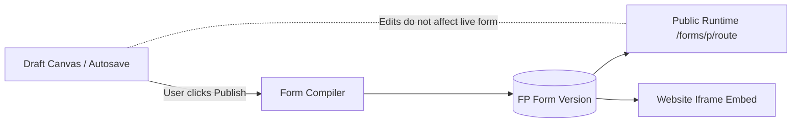
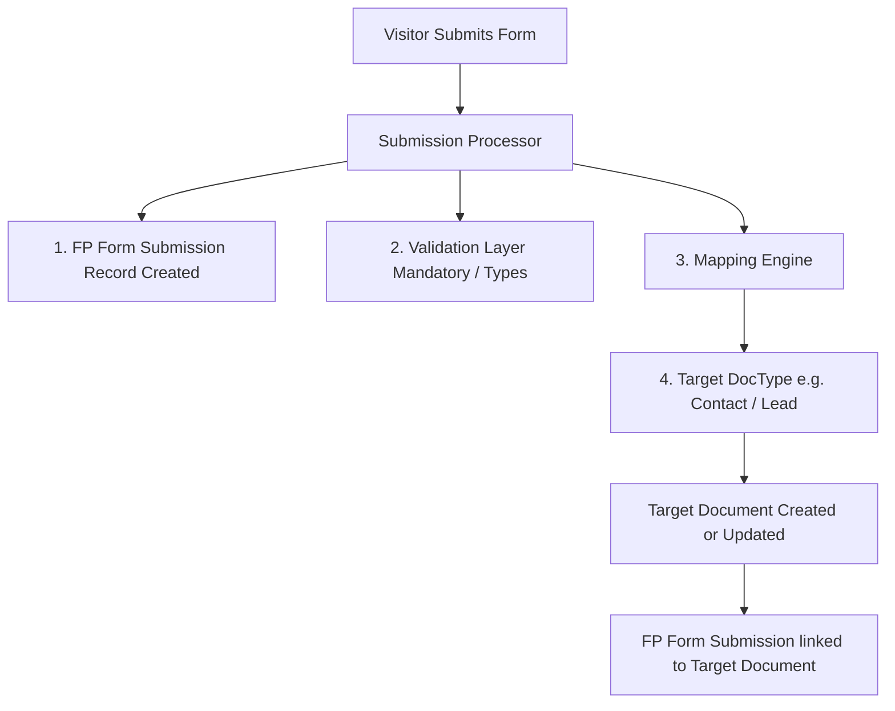

# Forms Pro — Consultant Implementation & Feature Guide
**Target Audience:** Implementation Consultants, Solution Architects, and QA Testers  
**Application:** `forms_pro` (Installed at `apps/forms_pro`)  
**Compatibility:** Frappe Framework v16 / ERPNext v16  
**Document Version:** 1.0 (Production Release)

---

## 1. Executive Summary & Purpose

**Forms Pro** is a modern, enterprise-grade form builder native to the Frappe Framework. It replaces Frappe's standard Web Forms with a HubSpot-inspired visual experience while remaining 100% integrated with Frappe DocTypes.

This guide is designed for **functional consultants and testers** to understand:
1. **What features have been built** in Forms Pro.
2. **How they match the client's requirements** item-by-item.
3. **Where to find and configure them** in the Desk and Form Studio.
4. **How the system works under the hood** (DocTypes, mapping engine, security, tracking).
5. **How to test each feature** step-by-step on the development server.

---

## 2. Client Requirements Compliance Matrix

Below is a direct comparison between the client's specification (*"17. Form Builder Editor for Website"*) and the implemented solution in Forms Pro:

| # | Client Requirement | Status in Forms Pro | Where It Is Located / Configured | Underlying Mechanism |
|---|---|---|---|---|
| **1** | **Website Embed Code** | ✅ Fully Supported | **Manage Form → Share & Embed tab** or **Studio Header → Share** | Dynamic responsive iframe snippet with auto-height postMessage resize and GTM `dataLayer` events. |
| **2** | **Standalone Form Page** | ✅ Fully Supported | **Manage Form → Share & Embed tab** or **Public Route** (`/forms/p/<route>`) | Public Vue 3 SPA page served directly at `/forms/p/<custom-route>`. |
| **3** | **Multiple Site Forms (Multi-step)** | ✅ Fully Supported | **Studio → Build Tab → Top Step Bar** (`+ Add Step`) | Step Manager supporting multi-step forms with progress indicators, forward/backward navigation, and per-step validation. |
| **4** | **Single Site Forms** | ✅ Fully Supported | **Studio → Build Tab** (Single step by default) | Standard single-page layout with multi-column grid support. |
| **5** | **Simple Drag-and-Drop Editor** | ✅ Fully Supported | **Studio → Build Tab** | Vue Draggable visual canvas with 3-column studio layout (Palette, Canvas, Inspector). |
| **6** | **Use Every Contact Field** | ✅ Fully Supported | **Studio → Left Sidebar → DocType Fields tab** | Live DocType introspector pulls all fields from `Contact` (or any selected DocType) with search and 1-click "Add Required Fields". |
| **7** | **Edit Labels Without Overwriting DocType** | ✅ Fully Supported | **Studio → Right Sidebar → Field Properties → Label** | Form field properties are decoupled from DocType schema. Renaming field labels in the form does NOT modify the Frappe DocType. |
| **8** | **Custom Form Fields Linked to Existing Fields** *(e.g. "Where does the solar get installed?" → `system_type_interest`)* | ✅ Fully Supported | **Studio → Right Sidebar → Field Properties → Logic tab → Map to DocType Field** | Forms Pro Mapping Engine: allows arbitrary form field names/labels and maps them to target DocType fields via `Direct`, `Constant`, or `Transform` mapping. |
| **9** | **Mandatory Fields** | ✅ Fully Supported | **Studio → Right Sidebar → Field Properties → Validation tab → Mandatory checkbox** | Two-tier enforcement: client-side visual validation and server-side blocking before document insertion. |
| **10** | **Hidden Fields with Preset Values** *(e.g. `language = "german"` and hidden)* | ✅ Fully Supported | **Studio → Right Sidebar → Field Properties → Validation tab → Hidden checkbox + Default value** | Secure Server-Side Default Injection: hidden fields use the configured default on the server, ignoring tampered browser payloads. |
| **11** | **Headings, Textfields & Descriptions** | ✅ Fully Supported | **Studio → Left Sidebar → Add Fields → Layout (Heading 1, 2, 3)** & **Field Properties → Help Text** | Presentation field types (`Heading 1-3`, `Page Break`) and per-field Help Text rendered below inputs. |
| **12** | **File Upload Field** | ✅ Fully Supported | **Studio → Left Sidebar → Add Fields → Upload (`Attach`)** | Frappe Attach field integration supporting file size limits, mime types, and public uploads. |
| **13** | **Colors, Shapes, Fonts (Corporate Design)** | ✅ Fully Supported | **Studio → Design Tab (Theme Editor)** | Dedicated Theme Editor for Google Fonts, brand colors, input/button/card border radius, form width, and custom CSS. |
| **14** | **Publish Button & Safe Drafts** | ✅ Fully Supported | **Studio Header → "Publish" / "Publish changes"** | Immutable Versioning: Draft changes autosave safely without affecting live forms until explicitly published. |
| **15** | **Preview Function (Desktop/Tablet/Mobile)** | ✅ Fully Supported | **Studio Header → "Preview" Button** | Interactive preview modal with Desktop (100%), Tablet (768px), and Mobile (375px) views plus landscape toggle. |
| **16** | **Archive Forms** | ✅ Fully Supported | **Studio Header → More Menu (`...`) → Archive** | Moves form to `Archived` status, disabling public route while preserving all historical submissions and links. |
| **17** | **Invisible reCAPTCHA Protection** | ✅ Fully Supported | **Frappe Desk → Forms Pro Settings** (Single DocType) | Google reCAPTCHA v3 invisible verification with configurable score threshold (default 0.5) and fail-closed security. |
| **18** | **Track Form Submissions in Time Span** | ✅ Fully Supported | **Studio → Analytics Tab** and **Manage Form → Overview** | KPI metric cards (Total, Success, Failed, Conversion Rate) and daily time-series volume charts between selected dates. |
| **19** | **Thank You Page & Google Ads Tracking** | ✅ Fully Supported | **Studio → Settings Tab (Success Mode)** or **Build Tab (Success Page Step)** | Supports designed thank-you page or redirect to external URL (`success_redirect_url`). Emits `formspro_form_submit` to `dataLayer`. |

---

## 3. High-Level Architecture for Consultants

### 3.1 The Form Lifecycle: Safe Publishing
Unlike older Frappe web forms where editing a field immediately broke live website visitors, Forms Pro uses an **immutable publishing workflow**:



1. **Draft Mode:** When you edit fields, change labels, or tweak themes in the Studio, changes are saved to your working draft. Visitors on your website do NOT see these changes yet.
2. **Publishing:** Clicking **"Publish"** (or **"Publish changes"**) freezes the current draft into an immutable snapshot (`FP Form Version`).
3. **Runtime:** The live website standalone URL and iframe embed always load the active version snapshot. If you make a mistake while drafting, your production website remains 100% stable.

---

### 3.2 Target DocType & Mapping Engine
Forms Pro is **DocType-agnostic**. While the client asked specifically for `Contact` fields, Forms Pro works identically for `Lead`, `Customer`, `Opportunity`, `Issue`, `Job Applicant`, or any custom DocType.



- **Non-Destructive:** Forms Pro does **not** alter existing core DocTypes (it will never inject unwanted columns into ERPNext core doctypes like `Contact` or `Lead`).
- **Mapping Flexibility:**
  - **Direct:** Form field value maps 1:1 into the target field.
  - **Constant:** Form field always sends a fixed value (e.g. `lead_source = "Website Form"`).
  - **Form-Only / Unmapped:** Fields collected for survey or presentation purposes that don't need a column in the main DocType are safely stored in the submission's JSON payload.

---

## 4. Detailed Feature Tour & Where to Find Everything

### 4.1 Desk Navigation & Dashboard
- **Access Route:** Log in to Frappe Desk and navigate to `/forms` (or search **"Forms Pro"** in the awesomebar).
- **Dashboard View:**
  - Displays all created forms organized by **Team** or **Personal**.
  - Status indicators: `Published` (Green), `Draft` (Yellow), `Archived` (Gray).
  - Quick action to create a new form: Prompts for **Form Title**, **Target DocType** (e.g. `Contact`), and **Team**.

---

### 4.2 The Form Studio: The 6 Studio Tabs
When you click on any form to edit it, you enter the **Form Builder Studio**. Across the top header are 6 primary tabs:

```
[ Build ]   [ Design ]   [ Settings ]   [ Submissions ]   [ Versions ]   [ Analytics ]
```

---

### 4.3 Tab 1: Build (Drag-and-Drop Canvas & Fields)
The Build tab is where you structure your form:

```
┌─────────────────────────┬───────────────────────────────────┬─────────────────────────┐
│     LEFT PALETTE        │          CENTER CANVAS            │     RIGHT INSPECTOR     │
│                         │                                   │                         │
│ • DocType Fields (Search│  [ Step 1: Contact Info ] [ + ]   │  Field Properties:      │
│   and drag from Contact)│  ┌─────────────────────────────┐  │  • General:             │
│                         │  │ First Name    | Last Name   │  │    Label, Help Text     │
│ • Add Fields:           │  │ [         ]   | [         ] │  │  • Validation:          │
│   - Basic (Text, Phone) │  └─────────────────────────────┘  │    Mandatory, Hidden,   │
│   - Choice (Select, Lang│  ┌─────────────────────────────┐  │    Default value        │
│   - Date/Time           │  │ Email Address               │  │  • Logic & Mapping:     │
│   - Upload (Attach)     │  │ [                         ] │  │    Target field mapping,│
│   - Layout (Heading 1-3)│  └─────────────────────────────┘  │    Conditional rules    │
└─────────────────────────┴───────────────────────────────────┴─────────────────────────┘
```

#### Key Capabilities in the Build Tab:
1. **Using Contact Fields:**
   - Click the **"DocType Fields"** tab on the left sidebar.
   - All fields from the target DocType (`Contact`) are listed.
   - Use the search bar to find fields like `first_name`, `email_id`, `mobile_no`.
   - If a mandatory DocType field is missing, an alert button **"Add X required fields"** appears at the top. Clicking it auto-inserts all required fields instantly.
2. **Custom Labels & Help Texts:**
   - Select any field on the canvas.
   - In the right-hand sidebar under **General**:
     - Change the **Label** (e.g. change `email_id` to *"Your Work Email"*). This only changes the form label; it does **not** rename the field in ERPNext settings.
     - Add a **Placeholder** (e.g. *"name@company.ch"*).
     - Add **Help Text / Description** (e.g. *"We will never share your email with third parties"*).
3. **Form-Specific Custom Fields with Mapping:**
   - To create a custom question like *"Where does the solar get installed?"*:
     1. Drag a **Select** or **Data** field from the **"Add Fields"** palette onto the canvas.
     2. Set the Label to *"Where does the solar get installed?"*.
     3. Go to the **Logic** tab in the right inspector.
     4. In **"Map to DocType Field"**, select the target field from the dropdown (e.g. `system_type_interest` or `custom_installation_site`).
     5. Set Mapping Type to **Direct**.
     6. When a visitor submits, the answer is automatically saved into that Contact's record.
4. **Mandatory & Hidden Fields with Preset Values:**
   - Select the field and switch to the **Validation** tab in the right inspector:
     - **Mandatory (`reqd`):** Toggle on to prevent submission if empty.
     - **Hidden (`hidden`):** Toggle on to hide the field from visitors.
     - **Default Value:** Enter the desired preset (e.g., enter `german` or `de`).
     - *Client Requirement Match:* When `hidden` is checked and `default` is set to `german`, the field is completely invisible to visitors, and the server automatically assigns `language = "german"` upon creation.
5. **Multi-Step Forms (Multiple Site Forms):**
   - At the top of the canvas, look at the **Step Navigation Bar**.
   - Click **"+ Add Step"** to create Step 2, Step 3, etc.
   - Double-click any step title to rename it (e.g. *"1. Personal Details"*, *"2. Solar System Info"*, *"3. Confirmation"*).
   - Drag fields between steps or reorder them.
   - Visitors will see a clean numbered progress indicator and "Next / Previous" buttons.
6. **Conditional Logic:**
   - In the right inspector under **Logic → Conditional Logic**:
   - Create rules such as: *Show this field ONLY IF "Do you own the property?" equals "Yes"*.
7. **Success Page Tab:**
   - Located on the far right of the step bar.
   - Click **"Success Page"** to customize what visitors see immediately after submitting (Title, confirmation message, custom graphic).

---

### 4.4 Tab 2: Design (Corporate Identity & Styling)
Forms Pro features a dedicated **Theme Editor** to match your corporate branding:

- **Typography:**
  - Google Fonts dropdown: Choose from `Inter`, `Roboto`, `Open Sans`, `Poppins`, `Montserrat`, `Nunito`, or `Source Sans Pro`.
  - Base font size selector: `14px` to `20px`.
- **Colors:**
  - Text Color & Muted Text Color.
  - Form Background Color (e.g., pure white `#FFFFFF` or dark mode).
  - Primary Brand Color (e.g., Megasol Solar Blue `#0055A5` or `#1D4ED8`).
  - Primary Hover Color.
  - Input Border Color & Input Focus Ring Color.
- **Shapes & Spacing:**
  - **Input Radius:** `4px`, `6px`, `8px`, `12px`, or `9999px` (fully rounded pill).
  - **Button Radius:** Controls CTA submit button curvature.
  - **Card Radius:** Outer form card curvature (`8px` to `24px`).
  - **Form Max Width:** `640px`, `720px`, `800px`, `960px`, `1024px`, or `1200px`.
  - **Field Gap:** Vertical spacing between elements.
- **Device Viewport Preview:**
  - As you adjust sliders and color pickers, the right-hand live preview updates in real time with instant Desktop / Tablet / Mobile device simulation.

---

### 4.5 Tab 3: Settings (Routing, Security, Strategy & Redirects)
- **Public Route:** Customize the URL slug (e.g. `/forms/p/solar-calculator` or `/forms/p/contact-us`).
- **Access Mode:**
  - `Public`: Anyone on the internet can fill out the form without logging in.
  - `Requires Login`: Only authenticated Frappe users can access and submit.
- **Record Strategy:**
  - `Create New`: Always creates a new document (e.g., new `Contact` or `Lead`).
  - `Update Existing`: Updates an existing record if matched.
  - `Collect Submission Only`: Stores the submission in Forms Pro without inserting into the target DocType.
- **Post-Submission Success Action:**
  - `Designed Page`: Shows the custom in-form confirmation screen.
  - `Redirect to External URL`: Redirects the visitor to an external website URL (e.g. `https://megasol.ch/de/vielen-dank/`). This is critical for Google Ads conversion tracking.

---

### 4.6 Tab 4: Submissions (Audit Log & Data Browser)
- Central repository for all responses submitted through this form.
- Columns: `Submission ID`, `Submitted At`, `Status` (Success / Failed / Processing), `Target Document` (clickable link directly opening the created `Contact` in Frappe Desk), `UTM Source`, `Submitter IP`.
- Clicking any row opens the full audit inspector showing the exact JSON payload sent by the visitor and server mapping logs.

---

### 4.7 Tab 5: Versions (Rollback & Version Control)
- Displays all published versions (`VER-FORM-001`, `VER-FORM-002`, etc.).
- Shows timestamp, author, and schema hash.
- Allows rolling back to a previous version if an update needs to be reverted.

---

### 4.8 Tab 6: Analytics (Submission Tracking & Marketing Attribution)
- **Time Span KPIs:**
  - Total Submissions, Successful Submissions, Failed Submissions, Conversion Rate percentage.
  - Date Range Filter: Filter analytics by today, last 7 days, last 30 days, or custom date spans.
- **Submissions Trend Graph:**
  - Interactive daily bar/line chart showing submission volume over time.
- **Attribution & Marketing Channels:**
  - Breakdown by `UTM Source` (e.g. `google`, `newsletter`, `linkedin`).
  - Breakdown by `Referrer URL` (e.g. `https://megasol.ch/products/solar`).
  - Tracks `utm_campaign`, `utm_medium`, `utm_term`, `utm_content`, and Google Click ID (`gclid`).

---

## 5. Website Embedding & Google Analytics / Ads Tracking

### 5.1 Embed Code (Iframe with Auto-Resize)
To place the form onto any external website (WordPress, Webflow, custom CMS, or static HTML):
1. Navigate to **Manage Form → Share & Embed**.
2. Copy the generated embed snippet:

```html
<iframe
  src="https://your-domain.com/forms/p/solar-inquiry"
  width="100%"
  height="650px"
  frameborder="0"
  style="border: none; width: 100%; min-height: 650px;"
  allow="camera; microphone; autoplay; encrypted-media; fullscreen"
></iframe>
```

- **Seamless Auto-Resize:** The embedded form communicates its scroll height back to the host website via HTML5 `postMessage` (`formspro:resize`), preventing double scrollbars.
- **Allowed Embed Origins:** To protect against clickjacking, authorized website domains can be restricted in **Forms Pro Settings → Allowed Embed Origins**.

---

### 5.2 Google Analytics 4 & Google Ads Conversion Tracking
The client requested: *"We also need a thank you page, so we can track the form send-ins in google analytics / ads."*

Forms Pro provides **two methods** to track conversions:

#### Method A: External Thank You Page Redirect (Simplest for Google Ads)
1. Go to **Studio → Settings Tab**.
2. Under **Success Mode**, select **"Redirect to External URL"**.
3. In **Success Redirect URL**, enter your dedicated landing page:
   ```
   https://megasol.ch/de/vielen-dank-solar-anfrage
   ```
4. On that landing page, place your standard Google Ads Conversion Tag or Google Analytics Event trigger (fires on page load).

#### Method B: DataLayer Custom Event (For In-Page Embeds)
When a form is submitted successfully within an embed or standalone page, Forms Pro automatically pushes an event to Google Tag Manager's `dataLayer`:

```javascript
window.dataLayer.push({
  event: 'formspro_form_submit',
  form_name: 'Solar Inquiry Form',
  submission_id: 'SUB-2026-00042'
});
```

You can create a Custom Event Trigger in Google Tag Manager for `formspro_form_submit` to fire Google Ads conversion tags instantly without needing a full-page redirect.

---

## 6. Invisible reCAPTCHA Security Architecture

Forms Pro protects public forms against spam and bots using **Google reCAPTCHA v3**:

- **Invisible & Frictionless:** Unlike older reCAPTCHA v2 ("I am not a robot" checkboxes or picture puzzles), reCAPTCHA v3 runs completely invisibly in the background. Legitimate visitors never see a challenge or solve puzzles.
- **Server-Side Secret Evaluation:** The frontend requests a token from Google, which is forwarded with the submission. The server verifies the token against Google's API using the securely stored secret key (`get_password`).
- **Configurable Risk Threshold:**
  - Google assigns a risk score between `0.0` (likely a bot) and `1.0` (human).
  - The default threshold is configured at `0.5` in **Forms Pro Settings**. Any request scoring below this threshold is blocked with a clean user message.
- **Fail-Closed Security:** If CAPTCHA is enabled in settings but keys are missing or invalid, submissions are refused rather than allowing unprotected submissions.

---

## 7. Underlying Frappe DocTypes Reference

For consultants needing to inspect raw database records in Frappe Desk, here is the DocType reference:

| DocType Name | Type | Purpose | Key Fields |
|---|---|---|---|
| **`Form`** | Master | Main form definition and metadata | `title`, `target_doctype`, `route`, `is_published`, `status`, `access_mode`, `record_strategy`, `theme_overrides_json`, `active_version` |
| **`Form Field`** | Child Table | Fields inside a Form | `label`, `fieldname`, `fieldtype`, `reqd`, `hidden`, `default`, `target_field`, `mapping_type`, `conditional_logic`, `row_index`, `column_index` |
| **`FP Form Submission`** | Transaction | Permanent log of every form response | `form`, `target_doctype`, `target_document` (Dynamic Link to created record), `status`, `payload`, `utm_source`, `utm_campaign`, `gclid` |
| **`FP Form Version`** | Snapshot | Immutable archive of published forms | `version_number`, `published_at`, `published_by`, `schema_json`, `mapping_json`, `theme_json`, `schema_hash` |
| **`FP Form Theme`** | Master | Reusable corporate style themes | `theme_name`, `font_family`, `primary_color`, `background_color`, `input_radius`, `card_radius`, `custom_css` |
| **`Forms Pro Settings`** | Single | System-wide reCAPTCHA & embed settings | `captcha_provider`, `recaptcha_site_key`, `recaptcha_secret_key`, `default_score_threshold`, `allowed_embed_origins` |
| **`FP Team`** | Master | Multi-user team workspace | `team_name`, `users` (Table of `FP Team Member` with roles) |

---

## 8. Step-by-Step QA & Testing Guide for Consultants

Follow these 11 testing scenarios on your development server to verify all client requirements:

### Test Case 1: Create a Form Linked to Contact
1. Open Desk and go to `/forms`.
2. Click **"+ Create Form"**.
3. Enter Title: `Solar Web Inquiry Test`.
4. Select Target DocType: `Contact`.
5. Click **Create**.
6. **Expected Result:** The Studio opens with `Contact` set as the target DocType.

---

### Test Case 2: Use Contact Fields with Custom Labels & Help Text
1. In the Left Sidebar, click **"DocType Fields"**.
2. Find `first_name` and click `+` (or drag it onto the canvas).
3. Find `email_id` and add it.
4. Click on the `first_name` field on the canvas.
5. In the right sidebar under **General**:
   - Change Label to: `Your First Name`.
   - Add Placeholder: `e.g. Thomas`.
   - Add Help Text: `Please enter your legal first name.`.
6. Open Frappe Desk in another tab and check the `Contact` DocType setup.
7. **Expected Result:** The form displays the custom label, placeholder, and help text. The core `Contact` DocType fields in Frappe remain completely untouched and unaltered.

---

### Test Case 3: Custom Form Field Mapped to Existing Field
1. In the Left Sidebar, click **"Add Fields"**.
2. Under **Choice**, drag a **Select** field onto the canvas.
3. In the Right Sidebar:
   - Change Label to: `Where does the solar get installed?`.
   - In Options, enter:
     ```
     Single Family Home
     Commercial Building
     Agricultural Barn
     Other
     ```
   - Switch to the **Logic** tab.
   - Under **"Map to Contact Field"**, select an existing field (e.g. `salutation`, `designation`, or your custom interest field).
   - Ensure Mapping Type is **Direct**.
4. **Expected Result:** The custom question is mapped directly to the selected target field.

---

### Test Case 4: Hidden Field with Preset Language Value
1. In the Left Sidebar under **Add Fields**, drag a **Data** or **Language** field onto the canvas.
2. In the Right Sidebar under **General**, set Fieldname to `language`.
3. In the **Validation** tab:
   - Check **Hidden** (`hidden = 1`).
   - In **Default Value**, enter `german` (or `de`).
4. Look at the canvas: The field shows a dashed badge indicating it is hidden.
5. **Expected Result:** The field is invisible to public visitors, but its default value (`german`) is automatically injected into the created Contact on submission.

---

### Test Case 5: Multi-Step Form Configuration
1. At the top of the canvas, click **"+ Add Step"**.
2. Step 2 appears. Double-click the tab and rename it to `Solar Details`.
3. Drag the `Where does the solar get installed?` field into Step 2.
4. Drag a new **Attach** (File Upload) field into Step 2 (Label: `Upload Roof Photo or Architectural Plan`).
5. Double-click Step 1 and rename it to `Contact Info`.
6. **Expected Result:** A 2-step wizard is formed.

---

### Test Case 6: Mandatory Field Validation
1. Click the `email_id` field on the canvas.
2. Under the **Validation** tab, check **Mandatory** (`reqd = 1`).
3. Click the **"Preview"** button in the top header.
4. Leave the Email field blank and click "Next" or "Submit".
5. **Expected Result:** An error badge and inline validation message appear: *"Your Work Email is required"*, blocking submission.

---

### Test Case 7: Brand Theme Customization
1. Click the **Design** tab in the top header.
2. Change **Font Family** to `Poppins` or `Montserrat`.
3. Change **Primary Color** to Megasol Blue (`#0055A5`).
4. Set **Input Radius** to `12px` and **Button Radius** to `12px`.
5. Observe the live preview on the right.
6. Switch preview device mode between **Desktop**, **Tablet**, and **Mobile**.
7. **Expected Result:** All inputs, typography, and buttons reflect the corporate design immediately.

---

### Test Case 8: Publishing & Live Standalone Submission
1. In the header, click **"Publish"**.
2. Notice the status indicator changes from `Draft` to `Published`.
3. Click the **More Menu (`...`) → Open live form** (or copy the standalone URL from **Manage Form → Share & Embed**).
4. Fill out Step 1 (`First Name`, `Email`) and Step 2 (`Where does the solar get installed?`, upload a test photo).
5. Click **Submit**.
6. **Expected Result:**
   - The form submits successfully and displays the Thank You message (or redirects to the external URL).
   - In Frappe Desk, navigate to **Contact List**: A new `Contact` document exists containing the submitted name, email, mapped solar question answer, and language preset.

---

### Test Case 9: Submission Audit & Analytics Verification
1. Return to the Form Studio and click the **Submissions** tab.
2. Confirm the test submission appears in the list with status `Success`.
3. Click the row to verify the target document link directly opens the new `Contact`.
4. Click the **Analytics** tab:
   - Verify the Total Submissions count increased by 1.
   - Verify the submission date is recorded on the trend chart.

---

### Test Case 10: Iframe Embedding Test
1. In the Studio or Manage Form page, go to **Share & Embed**.
2. Copy the iframe code snippet.
3. Paste it into any external HTML test file or web page.
4. **Expected Result:** The form renders cleanly inside the iframe, submits without cross-origin errors, and auto-resizes to fit its contents.

---

### Test Case 11: Form Archiving
1. In the Studio header, click the **More Menu (`...`) → Archive**.
2. Confirm the prompt.
3. Try accessing the public form URL in an incognito window.
4. **Expected Result:** The public form URL displays an archived/unavailable page. Existing submission records and linked contacts in the database remain completely intact and accessible in Frappe Desk.

---

## 9. Summary & Contact

Forms Pro fulfills all 19 requirements outlined in the client specification. It combines the visual flexibility of modern SaaS form builders with deep, non-destructive Frappe v16 integration.

For technical inquiries or custom adapter configurations, refer to the codebase at `apps/forms_pro` or contact the development team.
